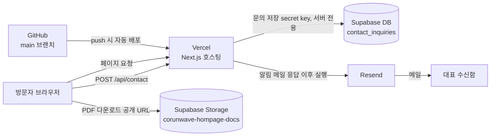

# HANDOVER — 코런웨이브 홈페이지 인수인계 (개발자용)

> 클라이언트용 요약 문서(Google Docs)의 기술 부록입니다. 요금제 한도는 수시로 바뀌므로 **기준일: 2026-11-02**, 각 항목의 공식 링크에서 재확인하세요.
> **이 문서에는 API 키·비밀번호를 적지 않습니다.** 실제 값은 별도 안전한 채널로 전달합니다.

## 1. 한눈에 보기

| 서비스 | 용도 | 현재 계정 | 이전 필요 |
| --- | --- | --- | --- |
| GitHub | 소스 코드 (`Corunwave/corunwave-homepage`) | Corunwave 조직 | 조직 Owner 권한 확인 |
| Vercel | 호스팅·배포 (Next.js) | 개발자 개인 계정 | **필수** (아래 상업적 이용 제한 참고) |
| Supabase | ① PDF 자료 Storage ② 문의 내역 DB | 개발자 개인 계정 | **필수** |
| Resend | 문의 접수 알림 메일 발송 | 개발자 개인 계정 | **필수** + 발신 도메인 인증 |

### 왜 회사 소유 계정이 필요한가

계정 소유자가 곧 서비스 소유자입니다. 개인 계정에 두면 담당자 변경·연락 두절 시 회사가 배포·문의 내역 조회·결제를 처리할 수 없고, 문의 내역(이름·연락처·이메일)의 개인정보 관리 주체도 회사가 되지 못합니다. 또 유료 전환의 결제·약관 당사자는 회사여야 하며(Vercel Hobby는 개인·비상업 전용), 요금 초과·일시정지 예고 메일이 회사 공용 메일로 와야 놓치지 않습니다.

### 클라이언트 준비물

- 회사 공용 이메일(담당자 변경과 무관하게 유지되는 주소) — 모든 서비스를 같은 주소로 가입
- 위 이메일로 생성한 Vercel 팀, Supabase 조직, Resend 계정
- GitHub 조직(Corunwave) Owner 2인 이상 (호스팅 서비스의 저장소 연결 승인에 필요)
- `crw.co.kr` DNS 관리 담당자 (Resend 메일 인증, 홈페이지 도메인 연결)
- 결제 수단과 결정권자, 문의 수신 메일 주소 확정

진행: 클라이언트가 계정을 만들고 결제 수단까지 등록 → 개발자를 이전 기간에만 멤버로 초대 → 이전·동작 확인 후 개발자 권한 회수, 개인 계정의 프로젝트·키 폐기.

## 2. 인프라 구조

문의 처리 흐름: 폼 제출 → `app/api/contact/route.ts`가 검증 후 **DB에 먼저 저장** → 응답 반환 → 이후 Resend로 메일 발송 → 발송 결과를 DB 행(`email_status`)에 기록. 메일이 실패해도 문의 자체는 DB에 남습니다.

## 3. Vercel

- **용도**: Next.js 앱 호스팅, GitHub 연동 자동 배포, `/api/contact` 서버 함수 실행.
- **이전 방법**: Project Settings → General → **Transfer Project**로 새 팀에 무중단 이전합니다. 이전하는 사람이 기존 팀 Owner이고 새 팀 멤버여야 하며, **새 팀에 결제 수단이 먼저 등록**되어 있어야 합니다. 사용량·로그는 이전되지 않고, Integration은 다시 추가해야 하며, 연결된 도메인은 이전 후 재확인합니다. 환경변수는 이전 후 값이 유지되는지 확인합니다. ([공식 안내](https://vercel.com/docs/projects/transferring-projects))
- **요금제 주의 (중요)**: Hobby(무료)는 **비상업·개인 용도 전용**입니다. 회사 홈페이지는 상업적 이용에 해당하므로 **운영 전환 시 Pro 이상이 필요**합니다.
- **Pro 요금(참고)**: 월 $20 (유료 좌석 1명 + 사용 크레딧 $20 포함), 유료 좌석 추가 시 1인당 월 $20, 읽기 전용 Viewer 좌석 무료.
- **Hobby 포함량(참고)**: 월 함수 호출 1,000,000회, Fast Data Transfer 100GB, Fast Origin Transfer 10GB, Active CPU 4시간. 초과 시 해당 기능이 30일간 제한됩니다.
- 공식: <https://vercel.com/docs/plans/hobby> · <https://vercel.com/docs/limits/fair-use-guidelines>

## 4. Supabase

- **Storage**: 공개 버킷 `corunwave-hompage-docs`에 회사소개서·포트폴리오 PDF 보관. URL은 `app/_content/site.ts`의 `DOCUMENTS_BASE_URL`과 `documents`에 있습니다. 버킷은 **ASCII 파일명만** 허용하며, 한글 저장 이름은 `?download=` 쿼리로 전달합니다.
- **DB**: `contact_inquiries` 테이블(문의 내역). 스키마는 `supabase/migrations/20261102000000_contact_inquiries.sql`. RLS가 켜져 있고 정책이 없어 **브라우저(anon)는 접근 불가**, 서버만 secret key로 접근합니다.
- **이전 방법 A (권장) — 프로젝트 이전 기능**: 기존 조직 Owner이자 새 조직 멤버인 사람이 Dashboard에서 새 조직으로 Transfer합니다. 조건: GitHub 연동·log drain이 없어야 합니다. 새 조직이 Free면 일부 기능이 제한될 수 있으므로 **새 조직을 먼저 Pro로 올리는 것을 권장**합니다. 프로젝트가 그대로 이동하므로 URL·키가 유지되어 코드 수정이 필요 없을 것으로 보이나, **Storage 버킷의 PDF가 함께 이전되는지는 공식 문서에 명시가 없으므로 이전 직후 다운로드 링크 전부를 확인**하세요. ([공식 안내](https://supabase.com/docs/guides/platform/project-transfer))
- **이전 방법 B — 새 프로젝트 생성**: 마이그레이션 SQL 실행 → 같은 이름의 공개 버킷 생성 후 PDF 재업로드 → (기존 문의 이관 필요 시) 테이블 데이터 export/import → `SUPABASE_URL`·`SUPABASE_SECRET_KEY` 교체 → **`site.ts`의 `DOCUMENTS_BASE_URL`을 새 프로젝트 주소로 수정**.
- **Pro 요금(참고)**: 조직당 월 $25 (DB 8GB, 파일 보관 100GB, 전송 250GB 포함).
- **무료 플랜 한도(참고)**: DB 500MB/프로젝트, 조직 단위 Storage 1GB, egress 5GB, 무료 프로젝트 2개. **한동안 활동이 적으면 프로젝트가 자동 일시정지**되며, 이 경우 PDF 다운로드와 문의 저장이 모두 중단됩니다. 정지 방지 조치는 개발자가 별도로 관리하며, Pro로 전환하면 이 제약은 없어집니다.
- 공식: <https://supabase.com/pricing> · <https://supabase.com/kb/faqs/platform/free-project-pausing>

## 5. Resend

- **용도**: 문의가 접수되면 대표 수신함으로 알림 메일 발송 (`replyTo`는 문의자 이메일).
- **도메인 인증 필수**: 인증 전에는 테스트 발신 주소(`onboarding@resend.dev`)로 **Resend 계정 본인 이메일에만** 발송됩니다. 운영에서는 회사 도메인(예: `crw.co.kr`)에 DNS 레코드(SPF/DKIM)를 등록해 인증한 뒤 `CONTACT_MAIL_FROM`을 해당 도메인 주소로 바꿔야 합니다.
- **무료 플랜 한도(참고)**: 월 3,000통, **일 100통**, 인증 도메인 3개. 일 한도는 UTC 자정 기준 초기화됩니다. 문의 알림 용도로는 충분하지만 스팸 폼 제출이 몰리면 일 한도에 걸릴 수 있습니다(허니팟 방어는 `route.ts`에 구현됨).
- 공식: <https://resend.com/pricing> · <https://resend.com/docs/knowledge-base/account-quotas-and-limits>

## 6. 환경변수

Vercel 프로젝트 설정(Production/Preview)과 로컬 `.env.local`에 필요합니다. 형식은 `.env.example` 참고.

| 이름 | 설명 |
| --- | --- |
| `SUPABASE_URL` | Supabase 프로젝트 URL (서버 전용) |
| `SUPABASE_SECRET_KEY` | Supabase secret API key (`sb_secret_...`). **`NEXT_PUBLIC_` 접두사 금지** |
| `RESEND_API_KEY` | Resend API 키 |
| `CONTACT_MAIL_FROM` | 발신 주소 (인증된 도메인) |
| `CONTACT_MAIL_TO` | 문의 수신 주소 (운영: 대표 이메일) |

## 7. GitHub 저장소

- 위치: `https://github.com/Corunwave/corunwave-homepage`
- 브랜치: `dev`(개발 통합, 기본 브랜치) → PR로 `main`에 병합. `main` 반영이 운영 배포 기준입니다.
- 작업 흐름: `feat/*`, `chore/*`, `refactor/*` 브랜치 → `dev` PR → `dev`→`main` PR.
- 명령어: `npm run dev` / `npm run build` / `npm run lint` (테스트 러너 없음).
- 주요 규칙은 `CLAUDE.md`·`AGENTS.md` 참고: 스타일은 `app/globals.css` 단일 파일, 폰트 Pretendard(본문)·A2Z(강조), Next.js 16 / React 19.
- 백엔드는 `backend/<도메인>/`에 domain·application·infrastructure 레이어로 구성되어 있으며, 문의하기(`backend/contact/`)가 기준 예시입니다.

## 8. 향후 CMS 도입 시 변경 지점

현재 모든 콘텐츠는 **코드에 하드코딩**되어 있고 수정하려면 배포가 필요합니다. CMS를 붙일 때 아래를 정확히 파악해야 합니다.

| 현재 위치 | 내용 | CMS 전환 시 고려 |
| --- | --- | --- |
| `app/_content/home.ts` | 홈 히어로·제안 대상·서비스 가치·다운로드·솔루션 | 섹션 단위 모델링, 강조 표기 `[[...]]` 문법(`renderText.tsx`) 처리 방식 |
| `app/_content/about.ts` | 회사 소개, 대표 메시지, 가치 | 단일 문서형 |
| `app/_content/solutions.ts` | AX 인프라·러닝 서비스 (약 580줄) | 중첩 구조가 깊음, 스키마 설계 필요 |
| `app/_content/partner-strategy.ts` | 파트너 전략, 로고 | 로고 이미지 자산 관리 |
| `app/_content/site.ts` | 푸터, 문의 CTA, **PDF 링크** | PDF는 Supabase Storage URL 직접 참조 → CMS 업로드로 대체 시 파일명(ASCII 제한)·다운로드명 규칙 유지 |
| `app/_content/legal/` | 개인정보처리방침·이용약관 | 법적 문서는 버전/시행일 관리 필요 |
| `app/news/page.tsx` | 뉴스 | 현재 목록 구조 확인 후 동적 라우트(`/news/[slug]`) 추가 필요 |
| `public/images`, `public/fonts` | 이미지·폰트 (약 35MB) | 이미지는 CMS/스토리지로, 폰트는 코드에 유지 |
| `next.config.ts` | `cacheComponents`, `partialPrefetching` 활성화 | CMS 데이터 fetch 시 캐시 재검증(revalidate) 전략을 이 설정에 맞춰 설계 |

CMS 후보와 무관하게 정해야 할 것: 편집 권한 주체, 미리보기/승인 흐름, 수정 후 반영 방식(재배포 vs 온디맨드 재검증), 이미지 호스팅 위치.

## 9. 이전 체크리스트

- [ ] 회사 공용 이메일 확정, `crw.co.kr` DNS 담당자·결제 수단·결정권자 확정
- [ ] 회사 명의 GitHub 조직 Owner 2인 이상 확보
- [ ] 클라이언트가 Vercel 팀(Pro)·Supabase 조직·Resend 계정 생성, 개발자를 이전 기간 멤버로 초대
- [ ] Vercel: Transfer Project → 환경변수·운영 브랜치·도메인 연결 확인
- [ ] Supabase: 새 조직을 Pro로 올린 뒤 프로젝트 Transfer → PDF 다운로드 확인 (새 프로젝트로 만든 경우에만 `DOCUMENTS_BASE_URL`·키 수정 후 재배포)
- [ ] Resend: 회사 계정에서 도메인 DNS 인증 → API 키 재발급 → `CONTACT_MAIL_FROM/TO` 운영 값으로 변경
- [ ] 이전 후 문의 폼 실제 제출 → DB 저장·메일 수신·PDF 다운로드 3가지 확인
- [ ] 개인 계정의 프로젝트·키 폐기(Revoke) 및 노출 이력 있는 키 교체
